# Workflow — ระบบบริหารจัดการเงินทุนวิจัย (RMS)

> **Input:** [02-to-be-process.md](02-to-be-process.md), [03-requirements.md](03-requirements.md), [04-architecture.md](04-architecture.md)
> เอกสารนี้เรียง workflow ทีละขั้นตามลำดับที่กำหนด

## สัญลักษณ์

| สี / รูป | ความหมาย |
|---|---|
| 🟦 กล่องสีฟ้า | ระบบ RMS ทำอัตโนมัติ (⚙️) |
| 🟩 กล่องสีเขียว | คนทำผ่านระบบ (✅) |
| 🟧 กล่องสีส้ม | ระบบภายนอก (MUReX, SAP, WOLF, e-GP, e-Office, แหล่งทุน) |
| ◇ ข้าวหลามตัด | จุดตัดสินใจ / ตรวจตามกฎ |
| เส้นประ | ข้อมูลไหลข้ามระบบ หรือเกิดแบบ async |

บทบาท: `PI` นักวิจัย · `FAC` คณะ (FAC_OFFICER / FAC_HEAD) · `RO` กองวิจัย · `LEGAL` นิติการ · `FIN` การเงิน/พัสดุ · `APPROVER` ผู้มีอำนาจ · `REVIEWER` ผู้ทรงคุณวุฒิ

---

## ลำดับขั้น

| # | ขั้นตอน | ผู้ทำ | ระบบ | ผลลัพธ์ |
|---|---|---|---|---|
| 1 | สร้าง application | นักวิจัย | MUReX | application |
| 2 | สร้าง award ของ application ที่ได้รับทุน | จนท. กบจ | MUReX | award |
| 3 | ดึงข้อมูล application + award เข้า RDS | จนท. กบจ | MUReX → RDS | โครงการใน RDS |
| 4 | สร้างเอกสารแจกแจงงบ CR-04 | นักวิจัย | RDS | CR-04 |
| 5 | ตรวจสอบเอกสาร | จนท. วิจัย ส่วนงาน | RDS | ผ่านการตรวจระดับส่วนงาน |
| 6 | ตรวจสอบเอกสาร | จนท. กบจ | RDS | ผ่านการตรวจของ กบจ |
| 7 | ตรวจสอบเอกสาร | จนท. กองคลัง | RDS | ผ่านการตรวจของกองคลัง |
| 8 | ◇ ถ้าเป็นแหล่งทุนภายนอก ตรวจว่าขอเบิกเงินยืมกองทุนหมุนเวียนหรือไม่ | _(รอระบุ)_ | RDS | แยกเส้นทาง ขอยืม / ไม่ขอยืม |
| 8.1 | ทำหนังสือขออนุมัติเบิกจ่ายเงินยืมกองทุนหมุนเวียน เสนอรองวิจัย | จนท. กบจ | _(รอระบุ)_ | หนังสือขออนุมัติ |
| 8.2 | อนุมัติเบิกจ่าย | รองวิจัย | e-Office | อนุมัติเบิกจ่าย |
| 8.3 | ดำเนินการเบิกจ่ายเงินจากกองทุนหมุนเวียน | จนท. กองคลัง | _(รอระบุ)_ | จ่ายเงินยืม |
| 8.4 | ตั้งลูกหนี้ | จนท. กองคลัง | _(รอระบุ)_ | ลูกหนี้เงินยืมกองทุนหมุนเวียน |
| 8.5 | เมื่อได้รับแจ้งจากแหล่งทุน ทำหนังสือขออนุมัติเบิกจ่ายเงินงวด เสนอรองวิจัย | จนท. กบจ | _(รอระบุ)_ | หนังสือขออนุมัติ |
| 8.6 | อนุมัติเบิกจ่าย | รองวิจัย | e-Office | อนุมัติเบิกจ่าย |
| 8.7 | ดำเนินการเบิกจ่ายเงินงวด | จนท. กองคลัง | _(รอระบุ)_ | จ่ายเงินงวด |
| 9 | หักเงินหมวด AP เพื่อจ่ายผ่าน Payroll | มหาวิทยาลัย | _(รอระบุ)_ | ยอดหมวด AP จ่ายผ่าน Payroll |
| 9.1 | ⚙️ เมื่อได้รับแจ้งโอนเงินจากแหล่งทุน แจ้ง HR ส่วนงาน | ระบบ RDS (อัตโนมัติ) | RDS | แจ้งเตือน HR ส่วนงาน |
| 9.2 | รันกระบวนการจ่ายเงินผ่าน Payroll | HR ส่วนงาน | _(รอระบุ)_ | จ่ายเงินผ่าน Payroll |
| 10 | ส่งกรอบงบประมาณ: สร้าง IO8 · สร้างใบ Supplement งบ · สร้างใบจองงบ | จนท. งานงบ กองคลัง | _(รอระบุ)_ | กรอบงบประมาณ |
| 11 | ออกใบเสร็จรับเงิน: สร้างใบเสร็จรับเงิน | จนท. งานการเงิน กองคลัง | _(รอระบุ)_ | ใบเสร็จรับเงิน |
| 12 | รับรู้รายได้จากแหล่งทุน: ออกใบสำคัญรับเงิน (RV) หรือใบสำคัญทั่วไป (JV) | จนท. งานบัญชี กองคลัง ด้านรับเงิน | _(รอระบุ)_ | บันทึกรายได้ |
| 13 | ◇ ตรวจสอบว่ามียืมเงินหรือไม่ | จนท. งานบัญชี กองคลัง ด้านจ่ายเงิน | _(รอระบุ)_ | แยกเส้นทาง มียืม / ไม่มียืม |
| 13.1 | หักเงินโอนจากแหล่งทุนเพื่อล้างหนี้เงินยืม ยอดเหลือส่งต่อขั้น 14 | จนท. งานบัญชี กองคลัง ด้านจ่ายเงิน | _(รอระบุ)_ | ล้างหนี้ + ยอดคงเหลือ |
| 14 | จ่ายเงิน | จนท. งานบัญชี กองคลัง | _(รอระบุ)_ | _(รอระบุ)_ |
| 15 | โอนเงินเข้าบัญชีส่วนงาน | จนท. งานการเงิน กองคลัง | _(รอระบุ)_ | เงินเข้าบัญชีส่วนงาน |
| 16 | รับเงินงบดำเนินการโครงการ ลงบัญชี | จนท. คลังส่วนงาน | _(รอระบุ)_ | บันทึกรับเงินงบดำเนินการโครงการ |
| **ขอใช้เงิน** | | | | |
| 17 | ขอใช้เงิน | นักวิจัย | _(รอระบุ)_ | คำขอใช้เงิน |
| 18 | ◇ ทำเรื่องเบิกจ่ายเงิน (เลือกประเภท) | คลังคณะ | _(รอระบุ)_ | แยกเส้นทาง 3 ประเภท |
| 18.1 | ยืมเงินจากคณะ | คลังคณะ | _(รอระบุ)_ | _(รอระบุ)_ |
| 18.2 | เบิกจ่ายตามจริง | คลังคณะ | _(รอระบุ)_ | _(รอระบุ)_ |
| 18.3 | เบิกทั้งก้อนเงินงวด ให้นักวิจัยบริหารจัดการเอง | คลังคณะ | _(รอระบุ)_ | _(รอระบุ)_ |

---

## ภาพรวม

```mermaid
flowchart LR
  classDef auto fill:#dbeafe,stroke:#2563eb,color:#1e3a8a
  classDef human fill:#dcfce7,stroke:#16a34a,color:#14532d
  classDef ext fill:#ffedd5,stroke:#ea580c,color:#7c2d12
  classDef todo fill:#f3f4f6,stroke:#9ca3af,color:#374151,stroke-dasharray:4 3

  subgraph L_PI["👤 นักวิจัย"]
    direction LR
    m1["1. สร้าง application<br/>🟧 MUReX"]:::ext
    r2["4. สร้าง CR-04<br/>เอกสารแจกแจงงบ"]:::human
    g1["17. ขอใช้เงิน"]:::human
  end

  subgraph L_FUND["🏦 แหล่งทุน"]
    direction LR
    t1(["แจ้งโอนเงิน<br/>(trigger เบิกเงินงวด + Payroll)"]):::ext
  end

  subgraph L_RO["🏢 จนท. กบจ"]
    direction LR
    m2["2. สร้าง award ของ application<br/>ที่ได้รับทุน · 🟧 MUReX"]:::ext
    r1["3. ดึงข้อมูล application + award<br/>เข้า RDS"]:::human
    r4["6. ตรวจสอบเอกสาร"]:::human
    l1["8.1 ทำหนังสือขออนุมัติ<br/>เบิกเงินยืมกองทุนหมุนเวียน"]:::human
    i1["8.5 ทำหนังสือขออนุมัติ<br/>เบิกจ่ายเงินงวด"]:::human
  end

  subgraph L_FAC["🏛️ จนท. วิจัย ส่วนงาน"]
    direction LR
    r3["5. ตรวจสอบเอกสาร"]:::human
  end

  subgraph L_TBD["❔ ผู้ทำ รอระบุ"]
    direction LR
    d1{"8. แหล่งทุนภายนอก?"}
    d2{"ขอเบิกเงินยืม<br/>กองทุนหมุนเวียน?"}
  end

  subgraph L_VP["✍️ รองวิจัย"]
    direction LR
    l2{"8.2 อนุมัติเบิกจ่าย<br/>เงินยืม<br/>🟧 e-Office"}:::ext
    i2{"8.6 อนุมัติเบิกจ่าย<br/>เงินงวด<br/>🟧 e-Office"}:::ext
  end

  subgraph L_FIN["💰 จนท. กองคลัง"]
    direction LR
    r5["7. ตรวจสอบเอกสาร"]:::human
    l3["8.3 เบิกจ่ายเงิน<br/>จากกองทุนหมุนเวียน"]:::human
    l4["8.4 ตั้งลูกหนี้"]:::human
    i3["8.7 เบิกจ่ายเงินงวด"]:::human
  end

  subgraph L_MU["🏫 มหาวิทยาลัย"]
    direction LR
    f0["9. หักเงินหมวด AP<br/>เพื่อจ่ายผ่าน Payroll"]:::human
  end

  subgraph L_SYS["⚙️ ระบบ RDS"]
    direction LR
    a1["9.1 แจ้ง HR ส่วนงาน<br/>ให้รัน Payroll"]:::auto
  end

  subgraph L_HR["👥 HR ส่วนงาน"]
    direction LR
    h1["9.2 รันกระบวนการ<br/>จ่ายเงินผ่าน Payroll"]:::human
  end

  subgraph L_BUD["💰 กองคลัง · งานงบ"]
    direction LR
    f1["10. ส่งกรอบงบประมาณ<br/>• สร้าง IO8<br/>• สร้างใบ Supplement งบ<br/>• สร้างใบจองงบ"]:::human
  end

  subgraph L_CASH["💰 กองคลัง · งานการเงิน"]
    direction LR
    f2["11. ออกใบเสร็จรับเงิน<br/>• สร้างใบเสร็จรับเงิน"]:::human
    f5["15. โอนเงินเข้าบัญชีส่วนงาน"]:::human
  end

  subgraph L_ACC["💰 กองคลัง · งานบัญชี"]
    direction LR
    f3["12. ด้านรับเงิน<br/>รับรู้รายได้จากแหล่งทุน<br/>• ออกใบสำคัญรับเงิน (RV)<br/>หรือใบสำคัญทั่วไป (JV)"]:::human
    f4{"13. ด้านจ่ายเงิน<br/>มียืมเงิน?"}
    f6["13.1 หักเงินโอนจากแหล่งทุน<br/>เพื่อล้างหนี้"]:::human
    fp["14. จ่ายเงิน"]:::human
  end

  subgraph L_UNIT["🏛️ จนท. คลังส่วนงาน"]
    direction LR
    u1["16. รับเงินงบดำเนินการโครงการ<br/>ลงบัญชี"]:::human
  end

  subgraph L_FACFIN["🏛️ คลังคณะ"]
    direction LR
    g2{"18. ทำเรื่องเบิกจ่าย<br/>ประเภทไหน?"}
    g3["18.1 ยืมเงินจากคณะ"]:::human
    g4["18.2 เบิกจ่ายตามจริง"]:::human
    g5["18.3 เบิกทั้งก้อนเงินงวด<br/>นักวิจัยบริหารจัดการเอง"]:::human
  end

  %% ทำสัญญา
  m1 --> m2
  m2 -.->|"application + award"| r1
  r1 --> r2 --> r3 --> r4 --> r5 --> d1

  %% แยกเส้นทางเบิก
  d1 -->|"ใช่"| d2
  d1 -->|"ไม่ใช่"| i1
  d2 -->|"ขอยืม"| l1
  d2 -->|"ไม่ขอยืม"| i1

  %% ยืมเงินกองทุนหมุนเวียน
  l1 --> l2 -->|"อนุมัติ"| l3 --> l4
  l4 --> n2(["รอระบุ"]):::todo

  %% เบิกจ่ายเงินงวด
  t1 -.->|"แจ้ง กบจ"| i1

  %% แหล่งทุนแจ้งโอนเงิน → Payroll
  t1 -.-> a1 --> h1
  h1 --> n8(["รอระบุ"]):::todo
  i1 --> i2 -->|"อนุมัติ"| i3

  %% กองคลัง → ส่วนงาน
  i3 --> f0 --> f1 --> f2 --> f3 --> f4
  f4 -->|"ไม่มียืม"| fp
  f4 -->|"มียืม"| f6
  f6 -->|"ยอดเหลือ"| fp
  fp --> f5
  f5 --> u1

  %% ขอใช้เงิน
  u1 --> g1 --> g2
  g2 -->|"ยืม"| g3
  g2 -->|"ตามจริง"| g4
  g2 -->|"ทั้งก้อน"| g5
  g3 --> n5(["รอระบุ"]):::todo
  g4 --> n6(["รอระบุ"]):::todo
  g5 --> n7(["รอระบุ"]):::todo
```

---

## 1. นักวิจัยสร้าง application

- **ผู้ทำ:** นักวิจัย
- **ระบบ:** MUReX (ภายนอก)
- **ผลลัพธ์:** application ของโครงการวิจัย

## 2. จนท. กบจ สร้าง award

- **ผู้ทำ:** จนท. กบจ
- **ระบบ:** MUReX (ภายนอก)
- **ผลลัพธ์:** award ของ application ที่ได้รับทุน

## 3. ดึงข้อมูล application + award เข้า RDS

- **ผู้ทำ:** จนท. กบจ
- **ระบบ:** MUReX → RDS
- **ผลลัพธ์:** โครงการใน RDS พร้อมข้อมูล application และ award

## 4. นักวิจัยสร้าง CR-04

- **ผู้ทำ:** นักวิจัย
- **ระบบ:** RDS
- **ผลลัพธ์:** เอกสารแจกแจงงบ CR-04

## 5. จนท. วิจัย ส่วนงาน ตรวจสอบเอกสาร

- **ผู้ทำ:** จนท. วิจัย ส่วนงาน
- **ระบบ:** RDS
- **ผลลัพธ์:** เอกสารผ่านการตรวจระดับส่วนงาน

## 6. จนท. กบจ ตรวจสอบเอกสาร

- **ผู้ทำ:** จนท. กบจ
- **ระบบ:** RDS
- **ผลลัพธ์:** เอกสารผ่านการตรวจของ กบจ

## 7. จนท. กองคลัง ตรวจสอบเอกสาร

- **ผู้ทำ:** จนท. กองคลัง
- **ระบบ:** RDS
- **ผลลัพธ์:** เอกสารผ่านการตรวจของกองคลัง

## 8. ◇ แหล่งทุนภายนอก — ตรวจการขอเบิกเงินยืมกองทุนหมุนเวียน

- **ผู้ทำ:** _(รอระบุ)_
- **ระบบ:** RDS
- **เงื่อนไข:** ถ้าเป็นแหล่งทุนภายนอก ให้ตรวจว่าขอเบิกเงินยืมกองทุนหมุนเวียนหรือไม่
  - ขอยืม → 8.1
  - ไม่ขอยืม → 8.5
  - ไม่ใช่แหล่งทุนภายนอก → 8.5

### 8.1 จนท. กบจ ทำหนังสือขออนุมัติเบิกจ่าย

- **ผู้ทำ:** จนท. กบจ
- **ระบบ:** _(รอระบุ)_
- **ผลลัพธ์:** หนังสือขออนุมัติเบิกจ่ายเงินยืมกองทุนหมุนเวียน เสนอรองวิจัย

### 8.2 รองวิจัยอนุมัติเบิกจ่าย

- **ผู้ทำ:** รองวิจัย
- **ระบบ:** e-Office (ภายนอก)
- **ผลลัพธ์:** อนุมัติเบิกจ่าย

### 8.3 จนท. กองคลัง เบิกจ่ายเงินจากกองทุนหมุนเวียน

- **ผู้ทำ:** จนท. กองคลัง
- **ระบบ:** _(รอระบุ)_
- **ผลลัพธ์:** จ่ายเงินยืมจากกองทุนหมุนเวียน

### 8.4 จนท. กองคลัง ตั้งลูกหนี้

- **ผู้ทำ:** จนท. กองคลัง
- **ระบบ:** _(รอระบุ)_
- **ผลลัพธ์:** ลูกหนี้เงินยืมกองทุนหมุนเวียน
- **ถัดไป:** _(รอระบุ)_

### 8.5 จนท. กบจ ทำหนังสือขออนุมัติเบิกจ่ายเงินงวด

กรณีไม่ใช่แหล่งทุนภายนอก หรือแหล่งทุนภายนอกที่ไม่ขอยืม

- **Trigger:** จนท. กบจ ได้รับแจ้งโอนเงินจากแหล่งทุน (trigger เดียวกับ 9.1)
- **ผู้ทำ:** จนท. กบจ
- **ระบบ:** _(รอระบุ)_
- **ผลลัพธ์:** หนังสือขออนุมัติเบิกจ่ายเงินงวด เสนอรองวิจัย

### 8.6 รองวิจัยอนุมัติเบิกจ่าย

- **ผู้ทำ:** รองวิจัย
- **ระบบ:** e-Office (ภายนอก)
- **ผลลัพธ์:** อนุมัติเบิกจ่ายเงินงวด

### 8.7 จนท. กองคลัง เบิกจ่ายเงินงวด

- **ผู้ทำ:** จนท. กองคลัง
- **ระบบ:** _(รอระบุ)_
- **ผลลัพธ์:** จ่ายเงินงวด
- **ถัดไป:** 9

## 9. มหาวิทยาลัยหักเงินหมวด AP เพื่อจ่ายผ่าน Payroll

- **ผู้ทำ:** มหาวิทยาลัย
- **ระบบ:** _(รอระบุ)_
- **ผลลัพธ์:** หักเงินหมวด AP เพื่อจ่ายผ่าน Payroll

### 9.1 ⚙️ ระบบแจ้ง HR ส่วนงาน

- **Trigger:** ได้รับแจ้งโอนเงินจากแหล่งทุน (trigger เดียวกับ 8.5)
- **ผู้ทำ:** ระบบ RDS (อัตโนมัติ)
- **ระบบ:** RDS
- **ผลลัพธ์:** แจ้ง HR ส่วนงานให้รันกระบวนการจ่ายเงินผ่าน Payroll

### 9.2 HR ส่วนงาน รันกระบวนการจ่ายเงินผ่าน Payroll

- **ผู้ทำ:** HR ส่วนงาน
- **ระบบ:** _(รอระบุ)_
- **ผลลัพธ์:** จ่ายเงินผ่าน Payroll
- **ถัดไป:** _(รอระบุ)_

## 10. จนท. งานงบ กองคลัง ส่งกรอบงบประมาณ

- **ผู้ทำ:** จนท. งานงบ กองคลัง
- **ระบบ:** _(รอระบุ)_
- **การดำเนินการ:**
  1. สร้าง IO8
  2. สร้างใบ Supplement งบ
  3. สร้างใบจองงบ
- **ผลลัพธ์:** กรอบงบประมาณ

## 11. จนท. งานการเงิน กองคลัง ออกใบเสร็จรับเงิน

- **ผู้ทำ:** จนท. งานการเงิน กองคลัง
- **ระบบ:** _(รอระบุ)_
- **การดำเนินการ:**
  1. สร้างใบเสร็จรับเงิน
- **ผลลัพธ์:** ใบเสร็จรับเงิน

## 12. จนท. งานบัญชี กองคลัง ด้านรับเงิน รับรู้รายได้จากแหล่งทุน

- **ผู้ทำ:** จนท. งานบัญชี กองคลัง ด้านรับเงิน
- **ระบบ:** _(รอระบุ)_
- **การดำเนินการ:**
  1. ออกใบสำคัญรับเงิน (RV) หรือใบสำคัญทั่วไป (JV)
- **ผลลัพธ์:** บันทึกรับรู้รายได้จากแหล่งทุน

## 13. ◇ จนท. งานบัญชี กองคลัง ด้านจ่ายเงิน ตรวจสอบการยืมเงิน

- **ผู้ทำ:** จนท. งานบัญชี กองคลัง ด้านจ่ายเงิน
- **ระบบ:** _(รอระบุ)_
- **เงื่อนไข:** ตรวจสอบว่ามียืมเงินหรือไม่
  - ไม่มียืม → 14
  - มียืม → 13.1

### 13.1 หักเงินโอนจากแหล่งทุนเพื่อล้างหนี้

- **ผู้ทำ:** จนท. งานบัญชี กองคลัง ด้านจ่ายเงิน
- **ระบบ:** _(รอระบุ)_
- **ผลลัพธ์:** หักเงินที่แหล่งทุนโอนมาเพื่อล้างหนี้เงินยืม (ลูกหนี้จากขั้น 8.4)
- **ถัดไป:** ยอดเหลือส่งไปขั้น 14

## 14. จนท. งานบัญชี กองคลัง จ่ายเงิน

- **ผู้ทำ:** จนท. งานบัญชี กองคลัง
- **ระบบ:** _(รอระบุ)_
- **ผลลัพธ์:** _(รอระบุ)_
- **ถัดไป:** 15

## 15. จนท. งานการเงิน กองคลัง โอนเงินเข้าบัญชีส่วนงาน

- **ผู้ทำ:** จนท. งานการเงิน กองคลัง
- **ระบบ:** _(รอระบุ)_
- **ผลลัพธ์:** เงินเข้าบัญชีส่วนงาน
- **ถัดไป:** 16

## 16. จนท. คลังส่วนงาน รับเงินงบดำเนินการโครงการลงบัญชี

- **ผู้ทำ:** จนท. คลังส่วนงาน
- **ระบบ:** _(รอระบุ)_
- **ผลลัพธ์:** บันทึกรับเงินงบดำเนินการโครงการเข้าบัญชีส่วนงาน
- **ถัดไป:** 17

---

# กระบวนการขอใช้เงิน

## 17. นักวิจัยขอใช้เงิน

- **ผู้ทำ:** นักวิจัย
- **ระบบ:** _(รอระบุ)_
- **ผลลัพธ์:** คำขอใช้เงิน
- **ถัดไป:** 18

## 18. ◇ คลังคณะทำเรื่องเบิกจ่ายเงิน

- **ผู้ทำ:** คลังคณะ
- **ระบบ:** _(รอระบุ)_
- **เงื่อนไข:** แยกตามประเภทการเบิกจ่าย 3 ประเภท
  - ยืมเงินจากคณะ → 18.1
  - เบิกจ่ายตามจริง → 18.2
  - เบิกทั้งก้อนเงินงวดไปบริหารจัดการเองโดยนักวิจัย → 18.3

### 18.1 ยืมเงินจากคณะ

- **ผู้ทำ:** คลังคณะ
- **ระบบ:** _(รอระบุ)_
- **ผลลัพธ์:** _(รอระบุ)_
- **ถัดไป:** _(รอระบุ)_

### 18.2 เบิกจ่ายตามจริง

- **ผู้ทำ:** คลังคณะ
- **ระบบ:** _(รอระบุ)_
- **ผลลัพธ์:** _(รอระบุ)_
- **ถัดไป:** _(รอระบุ)_

### 18.3 เบิกทั้งก้อนเงินงวด ให้นักวิจัยบริหารจัดการเอง

- **ผู้ทำ:** คลังคณะ
- **ระบบ:** _(รอระบุ)_
- **ผลลัพธ์:** _(รอระบุ)_
- **ถัดไป:** _(รอระบุ)_
